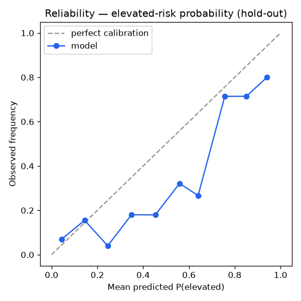

# Risk-Today Regime Classifier — Validation Report

_Auto-generated by `python -m backend.app.ml.validate` — do not edit by hand._

- **Data window:** 2012-10-22 → 2026-10-30 (3526 labeled rows)
- **Config:** seed 42 · 5 expanding folds · hold-out 20% · model_version regime-v1.1.0
- **Discipline:** all boundaries chronological (`TimeSeriesSplit` + final hold-out); a `horizon`-row PURGE/EMBARGO removes training labels whose forward window overlaps the test period; no random eval splits; the persistence baseline uses only labels observable at prediction time (ŷ(t) = y(t−horizon)).

## Headline conclusion — read this first

**On 4-class point accuracy the model LOSES to the persistence baseline (0.451 vs 0.521 mean fold accuracy).**
Classification is weak; the skill that survives honest validation is probabilistic. The elevated-risk probability beats the base-rate reference (Brier 0.1170 vs 0.1216; hold-out ROC-AUC 0.723). The model is therefore positioned as a **probability-ranking signal** (how much elevated-risk pressure is building), NOT a classifier — and this report exists to keep that claim honest, run after run.

## Walk-forward folds

| Fold | Test window | n | Acc | Macro-F1 | Log-loss | Majority acc | Persistence acc | Logistic acc |
|---|---|---|---|---|---|---|---|---|
| 1 | 2015-03-03 → 2017-06-28 | 587 | 0.4583 | 0.2529 | 1.6445 | 0.6354 | 0.5877 | 0.3237 |
| 2 | 2017-06-29 → 2019-10-28 | 587 | 0.6150 | 0.3074 | 1.3128 | 0.6303 | 0.6269 | 0.6388 |
| 3 | 2019-10-29 → 2022-02-25 | 587 | 0.3731 | 0.3083 | 1.6532 | 0.4208 | 0.5043 | 0.2998 |
| 4 | 2022-02-28 → 2024-06-28 | 587 | 0.3135 | 0.2197 | 1.9433 | 0.3526 | 0.4719 | 0.5196 |
| 5 | 2024-07-01 → 2026-10-30 | 587 | 0.4957 | 0.3766 | 1.2035 | 0.4855 | 0.4123 | 0.5060 |

## Model vs baselines (mean fold accuracy)

| Candidate | Mean accuracy |
|---|---|
| **HistGBM (the model)** | **0.4511** |
| Majority class | 0.5049 |
| Persistence (y at t−horizon) | 0.5206 |
| Logistic regression | 0.4576 |

Log-loss rows marked — mean a fold's training window never saw some test class (the skipped-row counts are in the JSON payload); majority and persistence emit no probabilities, so log-loss applies only to the model and the logistic baseline.

## Calibration — elevated-risk probability (hold-out)

Target: P(elevated risk) = P(volatile) + P(stress) · hold-out 706 rows · base rate 0.1416 · Brier 0.1170 (base-rate reference 0.1216)

| Predicted bin | n | Mean predicted | Observed frequency |
|---|---|---|---|
| [0.0, 0.1) | 328 | 0.0440 | 0.0701 |
| [0.1, 0.2) | 129 | 0.1446 | 0.1550 |
| [0.2, 0.3) | 75 | 0.2453 | 0.0400 |
| [0.3, 0.4) | 61 | 0.3490 | 0.1803 |
| [0.4, 0.5) | 39 | 0.4531 | 0.1795 |
| [0.5, 0.6) | 28 | 0.5592 | 0.3214 |
| [0.6, 0.7) | 15 | 0.6400 | 0.2667 |
| [0.7, 0.8) | 7 | 0.7566 | 0.7143 |
| [0.8, 0.9) | 14 | 0.8511 | 0.7143 |
| [0.9, 1.0] | 10 | 0.9408 | 0.8000 |

## Permutation feature importance (macro-F1, full fit)

| Feature | Importance |
|---|---|
| `vix_level` | 0.18633 |
| `vol_63d` | 0.15522 |
| `mom_60d` | 0.09427 |
| `yield_slope` | 0.09287 |
| `golden_cross` | 0.08522 |
| `vol_ratio` | 0.08333 |
| `vol_21d` | 0.06802 |
| `qqq_trend` | 0.0484 |
| `trend_sma50` | 0.04306 |
| `qqq_spy_spread` | 0.042 |
| `drawdown` | 0.04002 |
| `vix_change_5d` | 0.0388 |
| `mom_20d` | 0.03246 |
| `vix_term` | 0.02797 |
| `trend_sma200` | 0.02187 |

## Honest notes

- The estimator's internal `early_stopping` split is seeded but shuffled within each fit (see the model card's limitations).
- 4-class accuracy near the majority baseline is expected; the product-relevant signal is the elevated-risk probability, whose calibration is tabled above.
- Persistence is a STRONG baseline (regimes persist) — judge the model on the calibrated elevated-risk probability, not on beating persistence at 4-class point calls.
- Calibration bins sit on OVERLAPPING 10-day forward windows: adjacent rows share 9/10 return days, so the effective sample is roughly n/horizon and sparse upper bins may reflect only a couple of market episodes — read them as direction, not precision.
