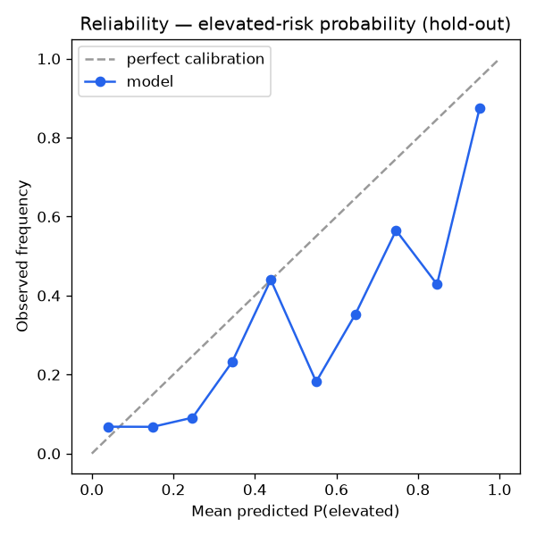

# Risk-Today Regime Classifier — Validation Report

_Auto-generated by `python -m backend.app.ml.validate` — do not edit by hand._

- **Data window:** 2012-10-15 → 2026-10-26 (3527 labeled rows)
- **Config:** seed 42 · 5 expanding folds · hold-out 20% · model_version regime-v1.1.0
- **Discipline:** all boundaries chronological (`TimeSeriesSplit` + final hold-out); a `horizon`-row PURGE/EMBARGO removes training labels whose forward window overlaps the test period; no random eval splits; the persistence baseline uses only labels observable at prediction time (ŷ(t) = y(t−horizon)).

## Headline conclusion — read this first

**On 4-class point accuracy the model LOSES to the persistence baseline (0.449 vs 0.521 mean fold accuracy).**
Classification is weak; the skill that survives honest validation is probabilistic. The elevated-risk probability beats the base-rate reference (Brier 0.1111 vs 0.1175; hold-out ROC-AUC 0.732). The model is therefore positioned as a **probability-ranking signal** (how much elevated-risk pressure is building), NOT a classifier — and this report exists to keep that claim honest, run after run.

## Walk-forward folds

| Fold | Test window | n | Acc | Macro-F1 | Log-loss | Majority acc | Persistence acc | Logistic acc |
|---|---|---|---|---|---|---|---|---|
| 1 | 2015-02-25 → 2017-06-22 | 587 | 0.4037 | 0.2052 | 1.7156 | 0.6303 | 0.5826 | 0.3254 |
| 2 | 2017-06-23 → 2019-10-22 | 587 | 0.6422 | 0.3100 | 1.2305 | 0.6303 | 0.6269 | 0.6388 |
| 3 | 2019-10-23 → 2022-02-18 | 587 | 0.3237 | 0.2450 | 1.8008 | 0.4276 | 0.5077 | 0.3066 |
| 4 | 2022-02-22 → 2024-06-24 | 587 | 0.3884 | 0.2740 | 1.8279 | 0.3458 | 0.4685 | 0.5145 |
| 5 | 2024-06-25 → 2026-10-26 | 587 | 0.4872 | 0.3747 | 1.1860 | 0.4923 | 0.4191 | 0.5111 |

## Model vs baselines (mean fold accuracy)

| Candidate | Mean accuracy |
|---|---|
| **HistGBM (the model)** | **0.4490** |
| Majority class | 0.5053 |
| Persistence (y at t−horizon) | 0.5210 |
| Logistic regression | 0.4593 |

Log-loss rows marked — mean a fold's training window never saw some test class (the skipped-row counts are in the JSON payload); majority and persistence emit no probabilities, so log-loss applies only to the model and the logistic baseline.

## Calibration — elevated-risk probability (hold-out)

Target: P(elevated risk) = P(volatile) + P(stress) · hold-out 706 rows · base rate 0.1360 · Brier 0.1111 (base-rate reference 0.1175)

| Predicted bin | n | Mean predicted | Observed frequency |
|---|---|---|---|
| [0.0, 0.1) | 338 | 0.0403 | 0.0680 |
| [0.1, 0.2) | 133 | 0.1495 | 0.0677 |
| [0.2, 0.3) | 77 | 0.2470 | 0.0909 |
| [0.3, 0.4) | 56 | 0.3443 | 0.2321 |
| [0.4, 0.5) | 25 | 0.4390 | 0.4400 |
| [0.5, 0.6) | 22 | 0.5503 | 0.1818 |
| [0.6, 0.7) | 17 | 0.6465 | 0.3529 |
| [0.7, 0.8) | 23 | 0.7463 | 0.5652 |
| [0.8, 0.9) | 7 | 0.8467 | 0.4286 |
| [0.9, 1.0] | 8 | 0.9512 | 0.8750 |

## Permutation feature importance (macro-F1, full fit)

| Feature | Importance |
|---|---|
| `vix_level` | 0.19528 |
| `vol_63d` | 0.16236 |
| `golden_cross` | 0.08507 |
| `vol_ratio` | 0.07926 |
| `yield_slope` | 0.07913 |
| `vol_21d` | 0.07141 |
| `mom_60d` | 0.06696 |
| `drawdown` | 0.04735 |
| `trend_sma50` | 0.0395 |
| `vix_change_5d` | 0.03709 |
| `qqq_trend` | 0.03689 |
| `qqq_spy_spread` | 0.03506 |
| `mom_20d` | 0.03158 |
| `vix_term` | 0.02819 |
| `trend_sma200` | 0.02002 |

## Honest notes

- The estimator's internal `early_stopping` split is seeded but shuffled within each fit (see the model card's limitations).
- 4-class accuracy near the majority baseline is expected; the product-relevant signal is the elevated-risk probability, whose calibration is tabled above.
- Persistence is a STRONG baseline (regimes persist) — judge the model on the calibrated elevated-risk probability, not on beating persistence at 4-class point calls.
- Calibration bins sit on OVERLAPPING 10-day forward windows: adjacent rows share 9/10 return days, so the effective sample is roughly n/horizon and sparse upper bins may reflect only a couple of market episodes — read them as direction, not precision.
